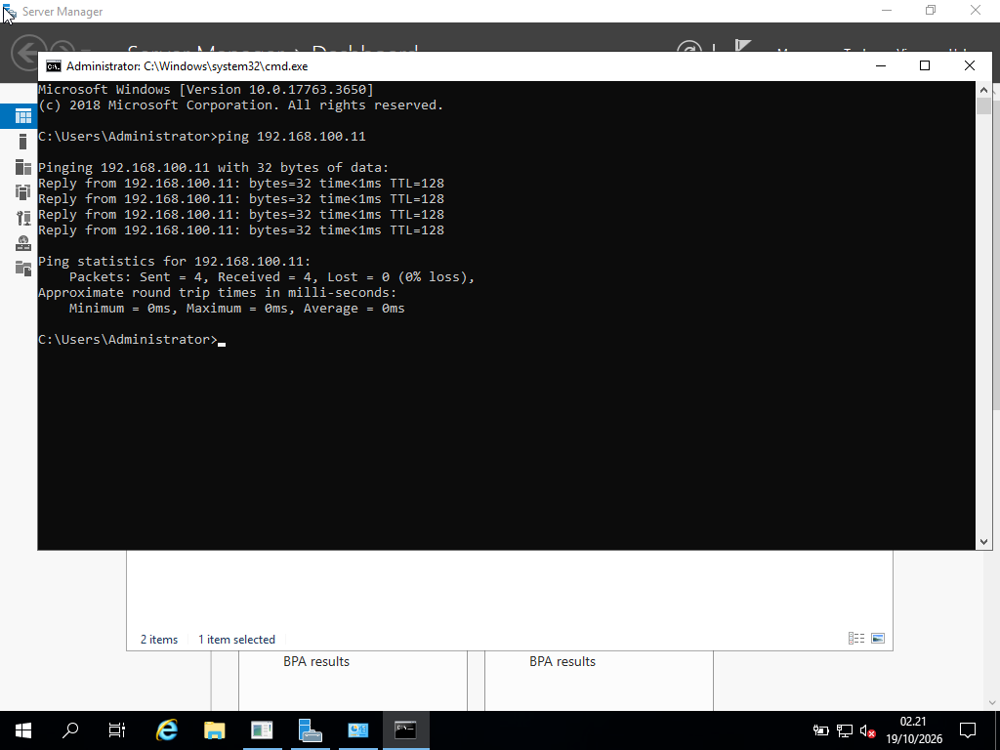

# 🖥️ Windows Server & Endpoint Administration — Home Lab Documentation

Repositori ini berisi dokumentasi praktik mandiri dalam membangun, mengelola, dan melakukan *troubleshooting* lingkungan jaringan **Server–Client** menggunakan **Windows Server** pada **Oracle VM VirtualBox**.

---

## ⚙️ Spesifikasi Lingkungan Virtual (Lab Environment)
* **Hypervisor:** Oracle VM VirtualBox
* **OS Server:** Windows Server (Domain Controller, DHCP, GPO, & SMB File Server)
* **OS Client:** Windows 10 / 11 Pro
* **Fokus Kompetensi:** Active Directory, Group Policy, Network File Sharing, Endpoint Troubleshooting & Firewall

---

## 1. Administrasi Active Directory (OU) & DHCP Server
* **Skenario Industri:** Mengelola akun pengguna dan komputer karyawan secara terpusat berdasarkan divisi menggunakan *Organizational Unit (OU)* serta mendistribusikan IP Address otomatis ke perangkat Client melalui layanan DHCP Server.

---

## 2. Pengujian Konektivitas Jaringan Dua Arah (ICMP Ping)
* **Skenario Industri:** Memverifikasi komunikasi jaringan antara Windows Server dan komputer Client menggunakan protokol ICMP (`ping`) di Command Prompt dengan hasil `0% packet loss`.

---

## 3. Centralized Software Deployment (SMB File Server — MS Office)
* **Skenario Industri:** Menyediakan *Shared Folder* terpusat pada Windows Server sebagai wadah penyimpanan *installer* aplikasi (**Microsoft Office**), sehingga tim IT Support dapat menjalankan instalasi langsung dari komputer Client melalui jaringan lokal (`\\IP-Server\Software`) tanpa perlu menggunakan *flashdisk* di setiap perangkat.
* **Perintah & Konfigurasi:** Pengaturan *SMB Sharing Permissions* & *NTFS Security* (Read & Execute).

<!-- Besok setelah upload gambar bernama fileshare-office.png, hapus tanda panah komentar di baris bawah ini: -->
<!--  -->

---

## 4. Penerapan Kebijakan Terpusat dengan Group Policy Objects (GPO)
* **Skenario Industri:** Menerapkan standarisasi keamanan dan pembatasan akses pada komputer karyawan secara massal dari sisi Server menggunakan **Group Policy Management** (seperti pembatasan akses *Control Panel* atau kebijakan keamanan akun) yang dihubungkan langsung ke *Organizational Unit (OU)*.
* **Perintah Verifikasi di Client:** `gpupdate /force` dan `gpresult /r`.

<!-- Besok setelah upload gambar bernama gpo-policy.png, hapus tanda panah komentar di baris bawah ini: -->
<!--  -->

---

## 5. Investigasi System Logs (Event Viewer) & Konfigurasi Windows Firewall
* **Skenario Industri:** Melacak penyebab *error* aplikasi, kegagalan layanan (*service*), maupun riwayat keamanan pada sistem operasi menggunakan **Windows Event Viewer** (*System & Application Logs*), serta mengatur aturan keluar-masuk trafik port pada **Windows Defender Firewall with Advanced Security**.

<!-- Besok setelah upload gambar bernama event-viewer-firewall.png, hapus tanda panah komentar di baris bawah ini: -->
<!--  -->
