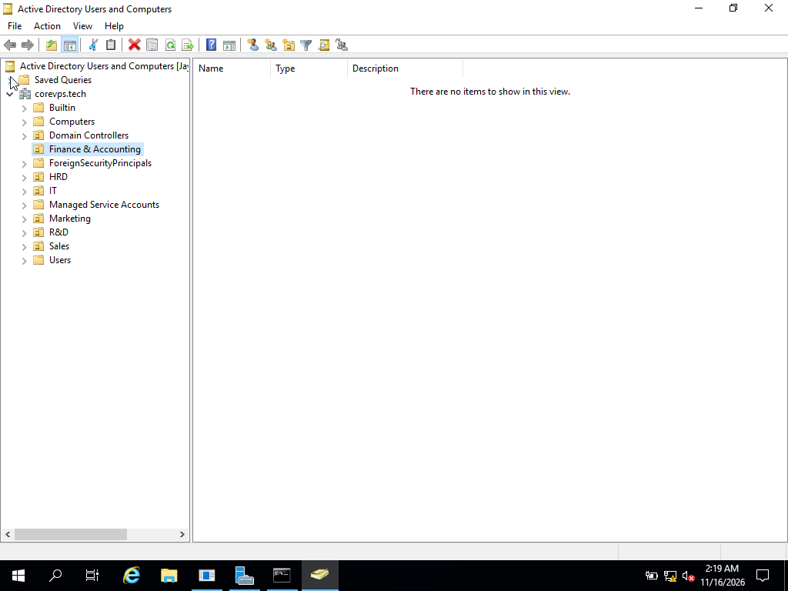
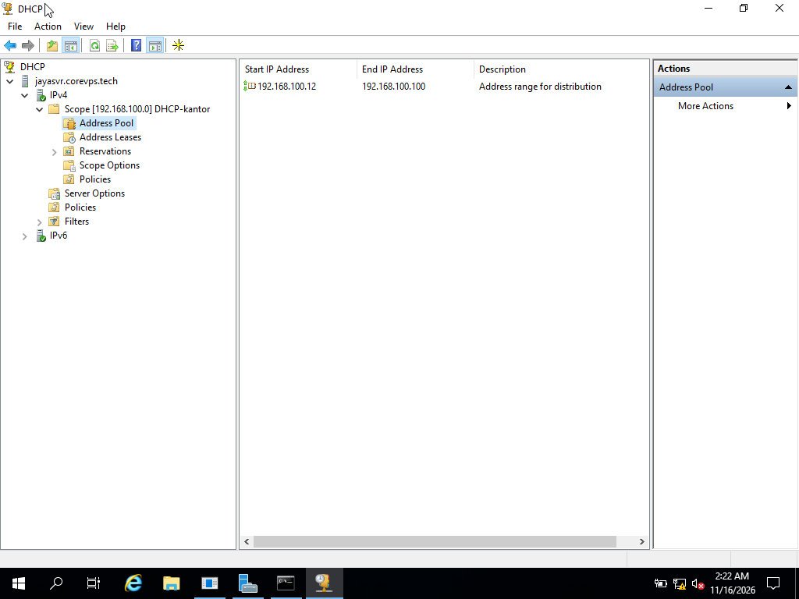
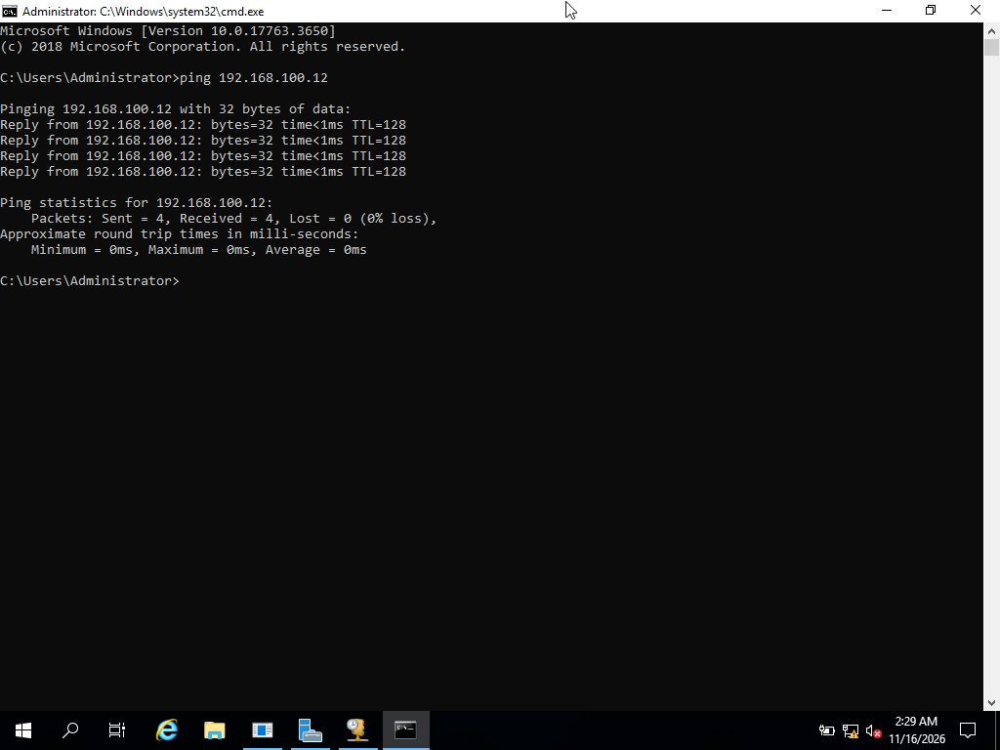
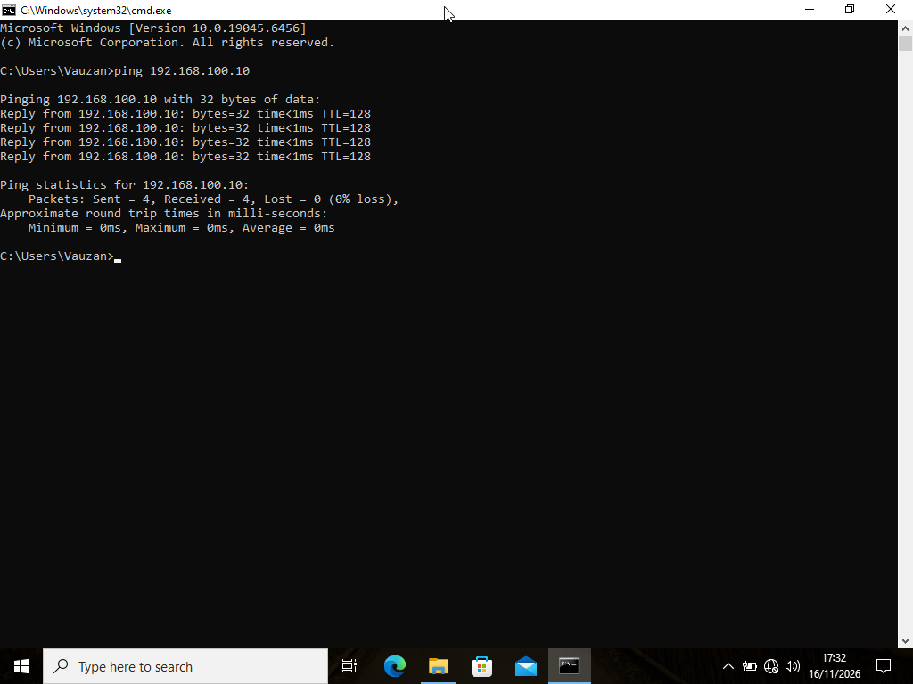
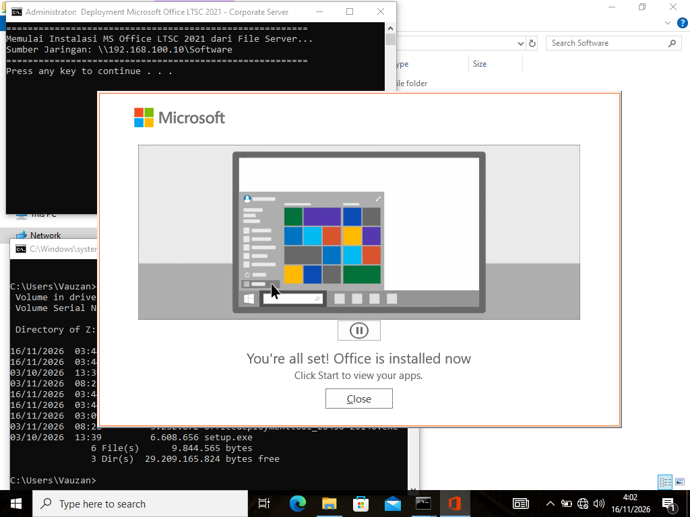
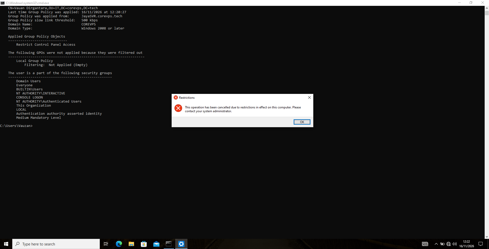
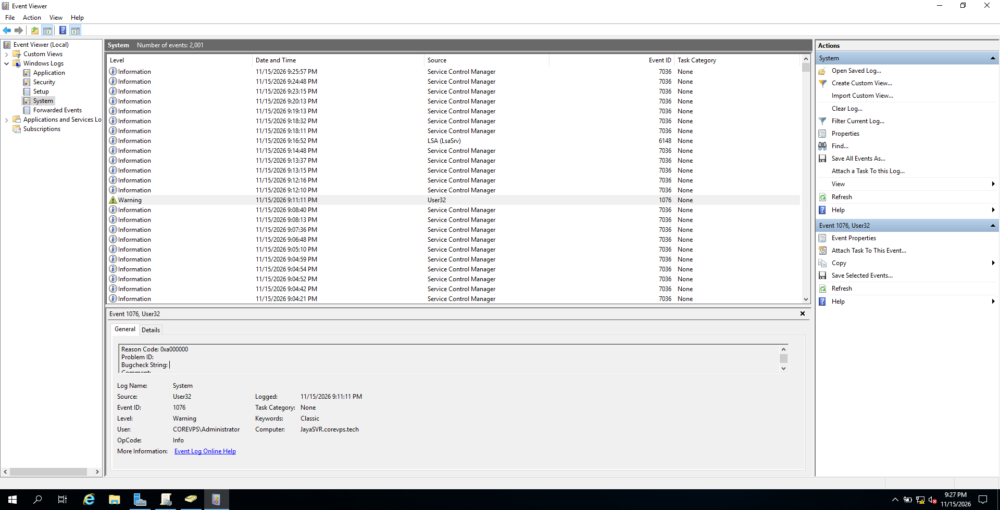
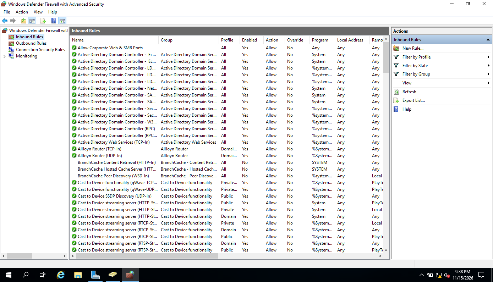

# 🖥️ Windows Server & Endpoint Administration — Home Lab Documentation

Repositori ini berisi dokumentasi praktik mandiri dalam membangun, mengelola, dan melakukan *troubleshooting* lingkungan jaringan **Server–Client** menggunakan **Windows Server** pada **Oracle VM VirtualBox**.

## ⚙️ Spesifikasi Lingkungan Virtual (Lab Environment)
- **Hypervisor:** Oracle VM VirtualBox
- **OS Server:** Windows Server (Domain Controller, DHCP, GPO, & SMB File Server)
- **OS Client:** Windows 10 Pro (Domain-Joined)
- **Fokus Kompetensi:** Active Directory, DHCP, Group Policy, Network File Sharing, Endpoint Troubleshooting & Firewall

## 1. Administrasi Active Directory Domain Services (AD DS) & Organizational Unit (OU)
- **Skenario:** Membangun *Domain Controller* dan merancang struktur **Organizational Unit (OU)** pada *Active Directory Users and Computers* (`dsa.msc`) untuk mengelompokkan akun pengguna serta perangkat komputer berdasarkan divisi kerja secara terpusat.

## 2. Konfigurasi Layanan DHCP Server (Dynamic IP Distribution)
- **Skenario:** Mengonfigurasi **DHCP Scope (IPv4 Address Pool `.10` - `.100`)**, *Default Gateway*, dan *DNS Server* pada Windows Server (`dhcpmgmt.msc`) agar komputer Client mendapatkan alamat IP secara otomatis (*Address Leases*).
- **Catatan Troubleshooting (Rogue DHCP & IP Conflict):** Mengisolasi *Network Adapter* ke jalur *Internal Network* dan melakukan pembaruan *lease* (`ipconfig /release` & `ipconfig /renew`) untuk mencegah tabrakan distribusi IP dengan *router* eksternal.

## 3. Pengujian Konektivitas Jaringan Dua Arah (ICMP Ping)
- **Skenario Industri:** Memverifikasi komunikasi jaringan timbal balik antara **Windows Server** dan komputer **Client** menggunakan protokol ICMP (`ping`) di Command Prompt dengan hasil `0% packet loss`.

### 3A. Uji Ping dari Server ke Client (`192.168.100.12`)

### 3B. Uji Ping dari Client ke Server (`192.168.100.10`)

## 4. Centralized Software Deployment (SMB File Server — MS Office LTSC 2021)
- **Skenario:** Menyediakan *Shared Folder* terpusat pada Windows Server (`\\192.168.100.10\Software`) sebagai wadah distribusi *installer* **Microsoft Office LTSC 2021**, sehingga tim IT Support dapat mengeksekusi instalasi langsung di komputer Client melalui jaringan lokal tanpa menggunakan *flashdisk* di setiap perangkat.
- **Konfigurasi & Otomatisasi:** Pengaturan *SMB Sharing Permissions*, *NTFS Security* (Read & Execute), pemetaan *Network Drive* (`net use Z:`), serta otomatisasi instalasi menggunakan **Office Deployment Tool (`setup.exe` & `Configuration.xml`)** yang dieksekusi melalui *Batch Script* (`Install_Office_LTSC.bat`).

## 5. Penerapan Kebijakan Terpusat dengan Group Policy Objects (GPO)
- **Skenario:** Menerapkan standarisasi keamanan dan pembatasan akses pada komputer karyawan secara massal dari sisi Server menggunakan **Group Policy Management** (`gpmc.msc`) yang dihubungkan langsung ke *Organizational Unit (OU)*.
- **Perintah Verifikasi di Client:** `gpupdate /force` dan `gpresult /r`.

## 6. Investigasi System Logs (Event Viewer) & Konfigurasi Windows Firewall
- **Skenario:** Melacak penyebab *error* aplikasi maupun layanan sistem operasi menggunakan **Windows Event Viewer** (`eventvwr.msc`), serta mengatur aturan keluar-masuk trafik *port* pada **Windows Defender Firewall with Advanced Security** (`wf.msc`).

### 6A. Audit Log Sistem melalui Windows Event Viewer

### 6B. Konfigurasi Inbound & Outbound Rules pada Windows Firewall

